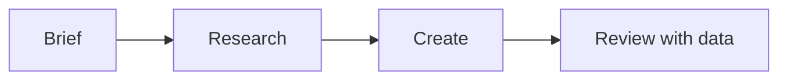

# Yelyzaveta Vasylenko

**B2B content and product marketer** | Remote

I turn customer conversations and search data into content, positioning. and launch plans that a team can act on.

## What I do

**Content, end to end**
Blog articles, LinkedIn, Instagram and other social platforms, expert-led articles, landing pages and etc.

**Research and strategy**
SEO keyword maps, go-to-market strategy, interviews with users.

## How I work

## My Marketing Stack

- **Analytics and data:** GA4
- **CRM and outbound:** HubSpot, LinkedIn Sales Navigator
- **Docs and collaboration:** GitHub Desktop, Markdown, Notion, Jira, Confluence
- **Content and design:** Canva, SEO tools, AI assistants

## Open to

Full-time, part-time and freelance roles. 

## Languages

Ukrainian (native), English (C1, IELTS 7.0, 2026), Spanish (A2)

[LinkedIn](https://www.linkedin.com/in/yelyzaveta-vasylenko-111abc) | [Email](mailto:lizavasylenko111@gmail.com)
